# serrure_rfid_01
Cet objet simule une serrure d'aspect contemporain qui s'ouvre et se ferme à l'aide d'un ou plusieurs badges RFID qui sont enregistrés en mémoire. De nombreux paramètres sont configurables via un back office accessible en wifi.

La serrure possède trois états
* FERMEE, la serrure est fermée
* OUVERTE, la serrure est ouverte
* BLOQUEE, la serrure est temporairement bloquée après avoir scanné plusieurs tags non enregistrés dans la serrure.

Par défaut, il n'y a aucun tag RFID enregistré dans la mémoire de la serrure. Pour l'utiliser en jeu, il faut donc au préalable enregistrer un ou plusieurs tags dans la mémoire de la serrure.

Une fois la serrure mise sous tension par batterie ou câble USB, elle se place dans l'état FERMEE. Si la serrure est éteinte, elle enregistre son état actuel et retourne dans cet état à l'allumage.

**[Exemple](#Exemple)** 
**[Composants](#Composants)**  
**[Branchements](#Branchements)**   
**[Installation du firmware](#Installation-du-firmware)**  
**[Mode d'emploi](#Mode-demploi)**  
**[Ajouter un tag RFID en mémoire](#Ajouter-un-tag-RFID-en-mémoire)**  
**[Back Office](#BackOffice)**  
**[Paramètres de gameplay](#paramètres-de-gameplay)**  
**[Paramètres Réseau](#paramètres-réseau)** 

## Exemple
Un exemple du kit technoLARP monté pour une serrure_rfid_01

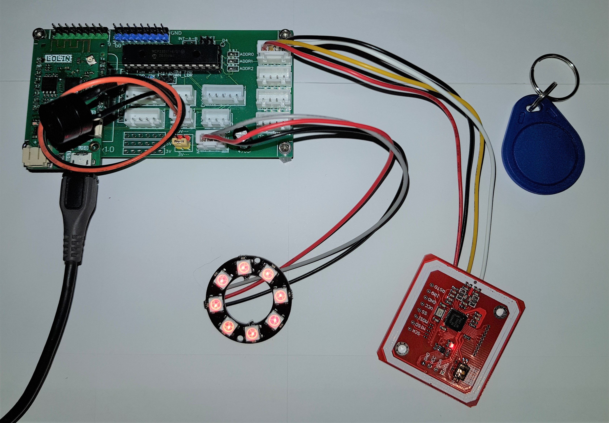

## Composants
Vous aurez besoin pour monter la serrure_rfid_01

|  | |
| :---------------- | :------: |
| Un kit technoLarp | 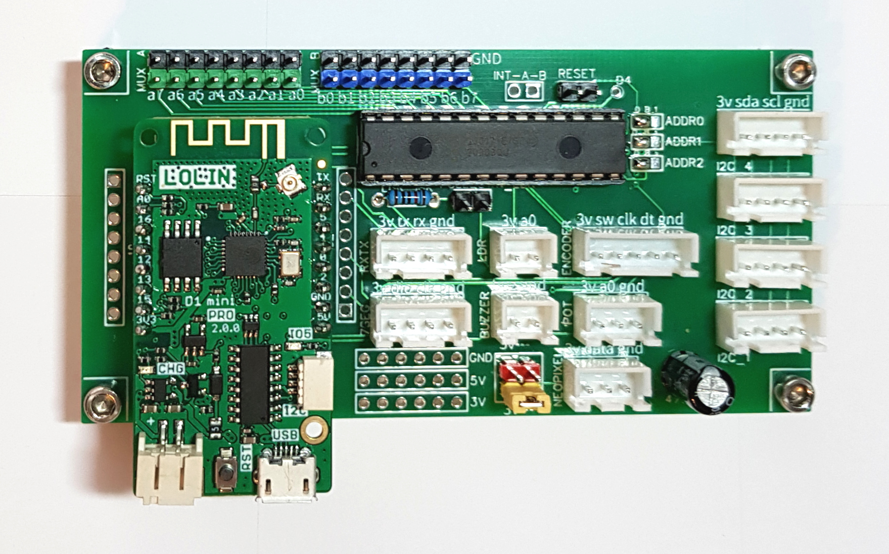 |
| Un câble micro-USB | 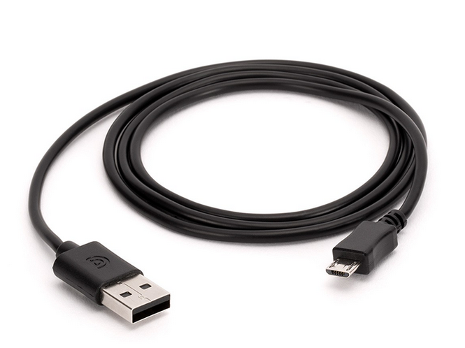 |
| Un ruban ou d'un anneau de led ws2812b ou neopixel | 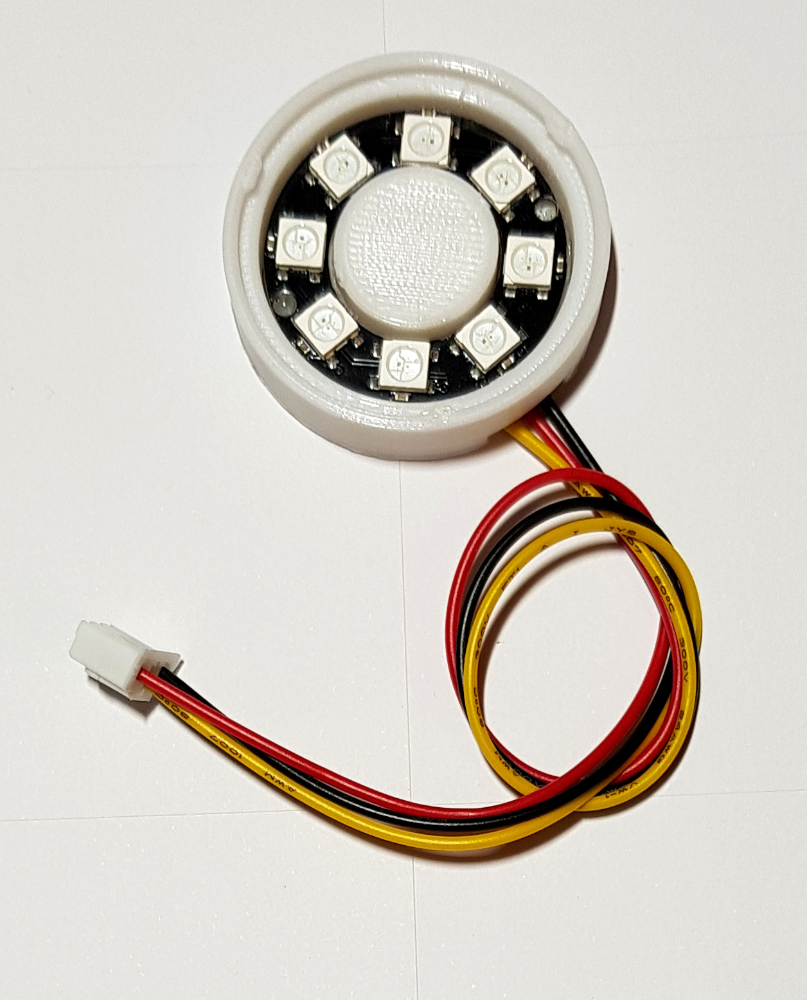 |
| Un buzzer piezo | 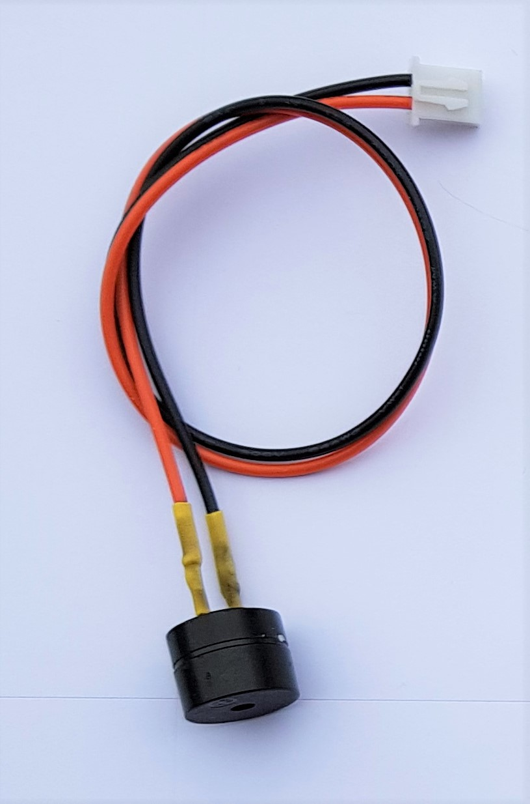 |
| 1 lecteur RFID PN532 configuré en mode I2C | 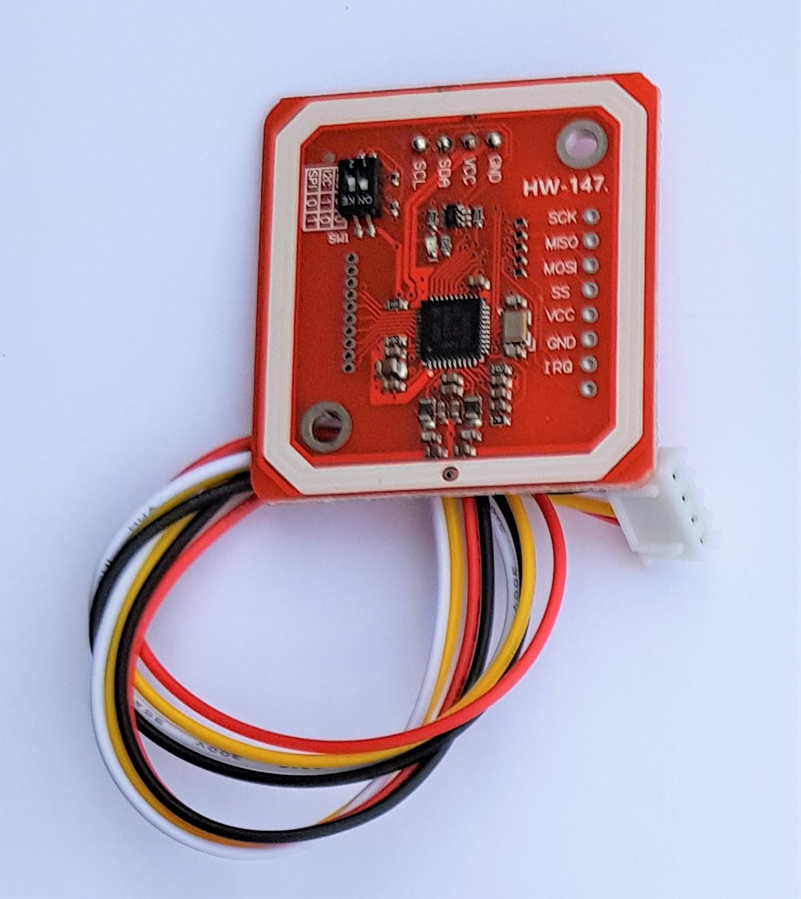 |
| Une batterie 18650 et son support | 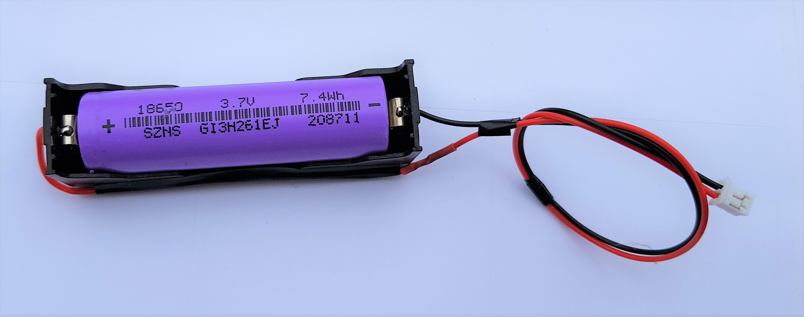 |

## Branchements
 - Branchez le lecteur RFID PN532 sur le connecteur I2C_1
 - Branchez le Ruban ou anneau led ws2812b sur le port "leds ws2812b"
 - Branchez le buzzer sur son port "buzzer"
 - Branchez la batterie sur son port dédié (sur le micro-contrôleur Wemos D1 mini pro)

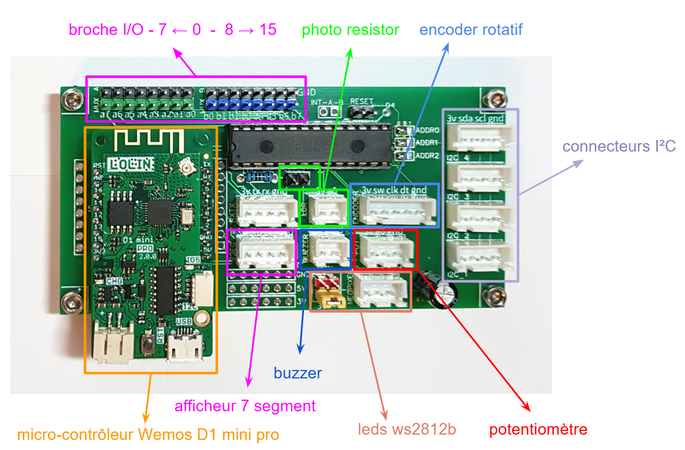

## Installation du firmware
Pour installer le firmware de l'objet, il faut suivre ce [tutorial](https://github.com/technolarp/technolarp.github.io/wiki/Installation-du-firmware)  

## Mode d'emploi

La serrure possède trois états :

* **FERMEE** : la serrure est fermée
* **OUVERTE** : la serrure est ouverte
* **BLOQUEE** : la serrure est temporairement bloquée après avoir scanné plusieurs tags non enregistrés dans la serrure.

Par défaut, il n'y a aucun tag RFID enregistré dans la mémoire de la serrure. Pour l'utiliser en jeu, il faut donc au préalable enregistrer un ou plusieurs tags dans la mémoire de la serrure.

Une fois la serrure mise sous tension par batterie ou câble USB, elle se place dans l'état FERMEE. Si la serrure est éteinte, elle enregistre son état actuel et retourne dans cet état à l'allumage.

On utilise des tags RFID de type MIFARE Classic 1K, fréquence 13.56MHz (norme ISO14443A). Ces tags se présentent sous de nombreuses formes :
|  | 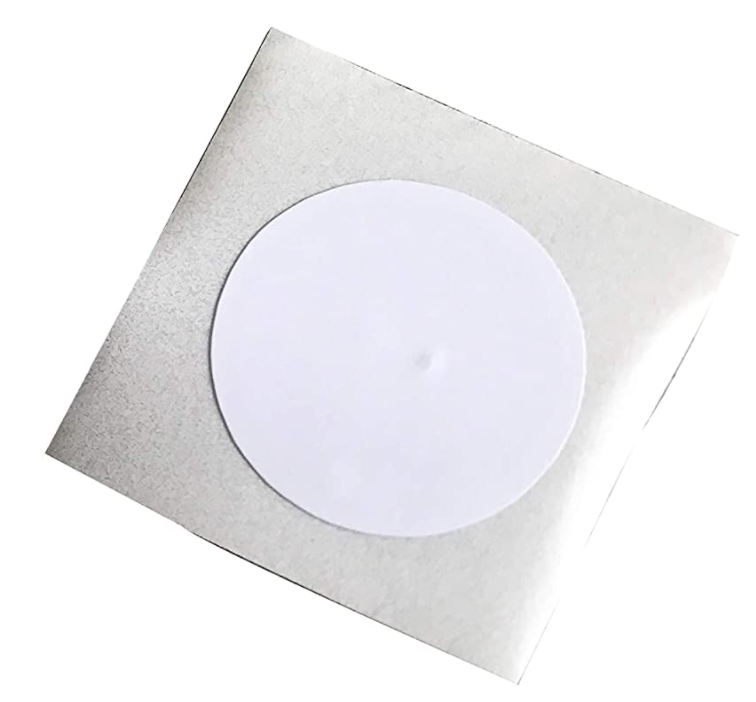 | 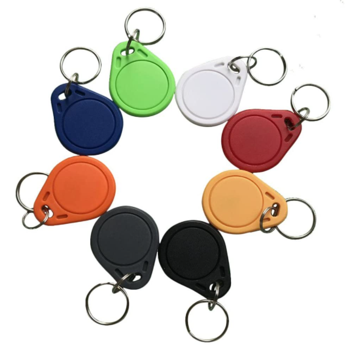 | 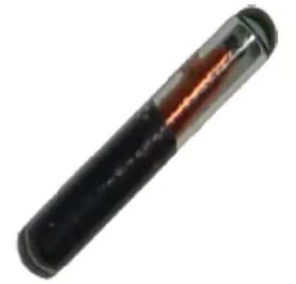 |
|---|---|---|---|

## Ajouter un tag RFID en mémoire

Pour ajouter un tag en mémoire :

1. Allumer la serrure
2. Se connecter au webUI
3. Scanner le tag qui doit être enregistré (le poser sur le lecteur RFID PN532)
4. Appuyer sur le bouton "Add last UID"
   => le tag a été ajouté dans la mémoire de la serrure

## BackOffice
Pour se connecter au back office de l'objet, il faut suivre ce [tutorial](https://github.com/technolarp/technolarp.github.io/wiki/Connexion-au-back-office-de-l'objet-via-le-wifi)  

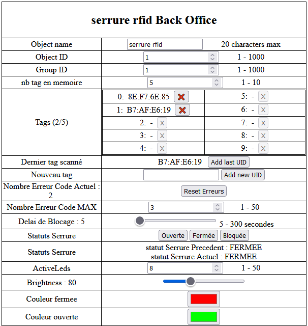

## Paramètres de gameplay
Ces paramètres permettent de contrôler le gameplay de l'objet.

| Nom                           | Descriptif                                                                                                                                                                       |
|-------------------------------|----------------------------------------------------------------------------------------------------------------------------------------------------------------------------------|
| **Object name**               | Le nom de l'objet, composé de 1 à 20 lettres et chiffres                                                                                                                         |
| **Object ID**                 | Un numéro d'identification de l'objet                                                                                                                                            |
| **Group ID**                  | Un numéro d'identification du groupe de l'objet                                                                                                                                  |
| **nb tag en mémoire**         | Le nombre de tags qui peuvent être stockés en mémoire. Chacun de ces tags ouvre ou ferme la serrure. Entre 1 et 10.                                                              |
| **Tags (x/5)**                | Le nombre de tags actuellement stockés en mémoire. Le bouton X permet de supprimer un tag.                                                                                       |
| **Dernier tag scanné**        | Le dernier tag qui a été scanné. Le bouton "add last UID" permet d'ajouter ce tag dans la mémoire de la serrure.                                                                 |
| **Nouveau tag**               | Ce champ permet d'ajouter manuellement un tag. Il doit être au format hexadécimal (exemple C0:E6:2F:25)                                                                         |
| **Nombre Erreur Code Actuel** | Le nombre de mauvais tags déjà scannés. Ce nombre repasse à 0 automatiquement quand le bon tag est scanné. Le bouton reset erreurs permet aussi de remettre ce compteur à 0.      |
| **Nombre Erreur Code MAX**    | Le nombre maximum d'erreurs. Une fois atteint, la serrure se bloque pendant plusieurs secondes (voir Délai de Blocage)                                                          |
| **Délai de Blocage**          | Le temps pendant lequel la serrure est bloquée après plusieurs faux codes                                                                                                        |
| **Statuts Serrure**           | Le statut actuel de la serrure. Les boutons permettent de forcer un changement de statut.                                                                                        |
| **ActiveLeds**                | Le nombre total de leds utilisées par la serrure. entre 1 et 25                                                                                                                  |
| **Brightness**                | La luminosité des leds, entre 0 (éteinte) et 255 (pleine intensité)                                                                                                              |
| **Scintillement**             | Le scintillement permet d'activer le scintillement des leds pour un effet visuel plus ou moins rapide. le slider permet de régler la vitesse du scintillement                    |
| **Couleur fermée**            | Choix de la couleur quand la serrure est en mode FERMEE                                                                                                                          |
| **Couleur ouverte**           | Choix de la couleur quand la serrure est en mode OUVERTE                                                                                                                         |

## Paramètres Réseau

Pour avoir le descriptif des paramètres réseau suivez ce [lien](https://github.com/technolarp/technolarp.github.io/wiki/Param%C3%A8tres-R%C3%A9seau)